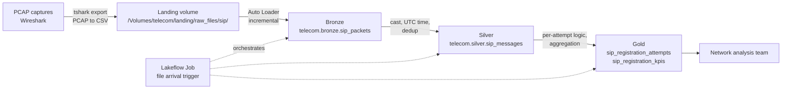

# telecom-pcap-lakehouse
# telecom-pcap-lakehouse

An end-to-end data engineering pipeline on **Databricks** that turns telecom signaling captures (Wireshark/PCAP) into network KPIs, using a **medallion architecture**, **Auto Loader**, **Unity Catalog**, a **Lakeflow Job** with a file arrival trigger, and **Databricks Asset Bundles** for deployment as code.

The use case comes from LTE/VoLTE network testing: test teams capture SIP/IMS signaling in Wireshark, and a network analysis team needs consistent, centralized KPIs such as IMS registration success rate and response time.

> All data in this repo comes from **public sample PCAPs** (CoLTE PCAP library, Wireshark sample captures). No proprietary or company data is used.

---

## Architecture



**Ownership boundary:** PCAP is a binary format and tshark cannot run on serverless compute, so the export from PCAP to CSV happens upstream (the capture side). Databricks owns everything from the landing zone onwards: ingestion, transformation, KPIs, and orchestration.

---

## Tech stack

| Area | Used |
|---|---|
| Platform | Databricks (Free Edition, serverless) |
| Governance | Unity Catalog: catalog `telecom`, schemas `landing`, `bronze`, `silver`, `gold`, volumes |
| Ingestion | Auto Loader (`cloudFiles`), schema inference, checkpointing |
| Processing | PySpark, Spark Structured Streaming, window functions |
| Storage | Delta Lake tables |
| Orchestration | Lakeflow Jobs, task dependencies, file arrival trigger |
| Deployment | Databricks Asset Bundles (DAB), Databricks CLI |
| Source capture | Wireshark / tshark, PyShark (local parser) |
| Version control | Git, GitHub, Databricks Git folders |

---

## Medallion layers

### Landing
Raw tshark CSV exports land in the Unity Catalog volume `/Volumes/telecom/landing/raw_files/sip/`.

Export command used per capture:
```bash
tshark -r input_logs/<file>.pcap -Y sip -T fields \
  -E header=y -E separator=, -E quote=d -E occurrence=l \
  -e frame.number -e frame.time_epoch -e ip.src -e ip.dst \
  -e sip.Call-ID -e sip.CSeq -e sip.Method -e sip.Status-Code \
  > exports/sip/<file>.csv
```
`occurrence=l` takes the **last** IP header, which is the inner (GTP-tunneled) address of the UE and IMS core rather than the outer transport address.

### Bronze: `telecom.bronze.sip_packets`
Notebook: `notebooks/01_bronze_sip.ipynb`
- Auto Loader reads new CSV files incrementally with a checkpoint, so reruns never duplicate data.
- Renames tshark's dotted column names to clean names (`frame.number` to `frame_number`, `sip.Call-ID` to `call_id`, etc.).
- Adds lineage columns: `source_file` (from `_metadata.file_path`) and `ingested_at`.
- Uses `trigger(availableNow=True)` and `awaitTermination()`.

### Silver: `telecom.silver.sip_messages`
Notebook: `notebooks/02_silver_sip.ipynb`
- Casts types: frame number to int, epoch to UTC timestamp, status code to int.
- Splits `CSeq` (`84496613 REGISTER`) into `cseq_num` and `cseq_method`.
- Deduplicates with `row_number()` over a window partitioned by `call_id, cseq, method, status_code`, keeping the earliest copy.

### Gold
Notebook: `notebooks/03_gold_sip_registration.ipynb`

**`telecom.gold.sip_registration_attempts`**: one row per IMS REGISTER attempt, with request time, final response, response time in ms, and an outcome:

| Outcome | Rule |
|---|---|
| `SUCCESS` | final status 2xx |
| `AUTH_CHALLENGE` | 401 Unauthorized (normal IMS step, not a failure) |
| `FAILURE` | any other final status, e.g. 504 Server Time-out |
| `NO_RESPONSE` | no final response captured |

**`telecom.gold.sip_registration_kpis`**: total attempts, successful, failed, average response time, success rate %.

**Sample result** (`4_sip.pcap`): 1 registration attempt, REGISTER → 100 Trying → **504 Server Time-out**, outcome `FAILURE`, response time about 3,000 ms, success rate 0%.

---

## Orchestration

A Lakeflow Job runs the three notebooks as chained tasks on serverless compute:

```
bronze_sip  →  silver_sip  →  gold_sip
```

- **Trigger:** file arrival on `/Volumes/telecom/landing/raw_files/sip/`. Uploading a new export launches the job automatically.
- **The job decides _when_ to run; Auto Loader's checkpoint decides _what_ is new.** A run triggered by a new file reads only that file's rows.

---

## Deployment with Databricks Asset Bundles

The job is defined as code in this repo:

```
databricks.yml                  # bundle name, dev target
resources/telecom_sip_job.yml   # job, tasks, dependencies, trigger
```

Deploy and run from the CLI:
```bash
databricks auth login --host <workspace-url> --profile <profile>
databricks bundle validate --profile <profile>
databricks bundle deploy   --profile <profile>
databricks bundle run telecom_sip_job --profile <profile>
```

In `development` mode the job is prefixed with `[dev <user>]` and its trigger is paused automatically, so a dev deployment never competes with the production job.

---

## Design decisions

- **`availableNow` instead of a continuous stream.** Captures arrive in bursts, not continuously. `availableNow` processes everything new, then stops, so no compute is spent idling.
- **Export outside Databricks.** tshark cannot run on serverless compute; separating capture/export from ingestion mirrors a realistic team boundary.
- **Dedup in silver, not bronze.** The same SIP message is often captured at two network points. Bronze keeps every packet for auditability; silver applies the business rule.
- **401 is not a failure.** In IMS, the first REGISTER normally receives a 401 auth challenge. Counting it as a failure would wrongly lower the success rate, so gold tracks it as `AUTH_CHALLENGE`.
- **File arrival trigger, not table-update trigger.** The job writes to its own upstream tables, so a table-update trigger would make it re-trigger itself.
- **Silver uses overwrite.** At this data size a full rebuild is simple and guarantees correct dedup. At scale this would become an incremental `MERGE`.

## Known limitations

- **Capture-point inconsistency:** dedup keeps the earliest copy, so a request may show the UE's IP while its response shows the gateway's IP. A capture-point column and preference rule would fix this.
- **B2BUA Call-ID changes:** some IMS nodes rewrite the Call-ID mid-path. Correlating across them would need the ICID from the P-Charging-Vector header.
- Small sample data; the goal is the architecture and patterns, not volume.

---

## Repository structure

```
telecom-pcap-lakehouse/
├── databricks.yml               # Asset Bundle definition
├── resources/
│   └── telecom_sip_job.yml      # Lakeflow Job as code
├── notebooks/
│   ├── 00_setup.ipynb           # catalog, schemas, volumes
│   ├── 01_bronze_sip.ipynb      # Auto Loader ingestion
│   ├── 02_silver_sip.ipynb      # typing + dedup
│   └── 03_gold_sip_registration.ipynb  # registration KPIs
├── src/
│   └── parsers/sip_parser.py    # local PyShark parser (PCAP to bronze/silver CSV)
└── input_logs/                  # public sample PCAPs
```

---

## Roadmap

- [ ] VoLTE call KPIs in gold: call setup time (INVITE → 200 OK), call duration, call success rate
- [ ] Lakeflow Declarative Pipeline version of the same flow, with data quality expectations
- [ ] LTE attach KPIs from S1AP/NAS captures: attach success rate and failure causes
- [ ] Production target in the bundle and CI/CD deployment with GitHub Actions
- [ ] 5G SA (NGAP) support
- [ ] Dashboard on the gold tables